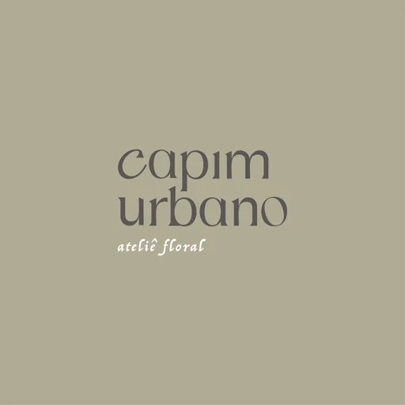
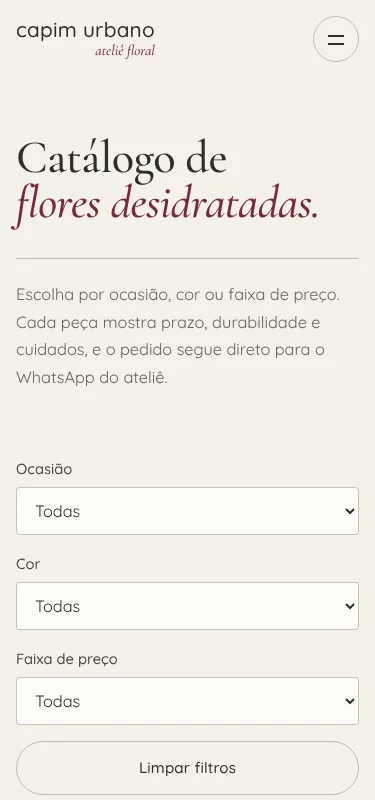
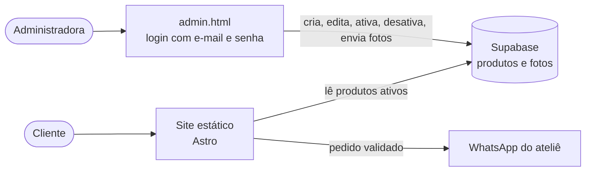
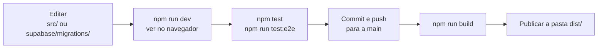

<p align="center">
  
</p>

<h1 align="center">Capim Urbano — Ateliê Floral</h1>

<p align="center">
  Site e catálogo digital de flores desidratadas, de Tubarão (SC).<br>
  O cliente escolhe, personaliza e conclui o pedido pelo WhatsApp. A administradora cuida dos produtos sozinha.
</p>

<p align="center">
  <sub>Feito por <a href="https://github.com/gstvdc"><strong>Gustavo Constante</strong></a> e <a href="https://github.com/LuqBruno"><strong>Bruno Luque</strong></a></sub>
</p>

<p align="center">
  
  &nbsp;
  
</p>

Planejamento, requisitos e andamento ficam no Trello:
[Capim Urbano — Kanban de Requisitos, Design e Desenvolvimento](https://trello.com/b/l6GKHhLH/capim-urbano-kanban-de-requisitos-design-e-desenvolvimento)

## Em resumo

| | |
|---|---|
| **O que é** | Site institucional + catálogo + pedido personalizado + administração de produtos |
| **Feito com** | [Astro](https://astro.build/) (site estático), JavaScript no navegador, CSS próprio e [Supabase](https://supabase.com/) (banco, login e fotos) |
| **Quem usa** | Clientes (catálogo e pedido), a administradora (`admin.html`) e a equipe técnica |
| **Como publica** | A cada push na `main`, o GitHub Actions faz o build e publica a pasta `dist/` no GitHub Pages (veja [Publicação](#publicação)) |
| **Como os produtos mudam** | A administradora salva em `admin.html` e o catálogo mostra para todos, **sem refazer o build** |

## Como o site funciona



**Quem pode o quê** é decidido pelo banco (regras de segurança por linha, RLS), não pela tela:

| Quem | Vê produtos | Altera produtos e fotos |
|---|---|---|
| Visitante | só os ativos | não |
| Conta logada que não é administradora | só os ativos | não |
| Administradora | todos, inclusive desativados | sim |

## Quem faz o quê

| Eu sou… | Quero… | Vá para |
|---|---|---|
| **Cliente** | ver produtos, filtrar e pedir | [`catalogo.html`](#páginas) e o [manual](docs/manual.md#para-o-cliente) |
| **Administradora** | cadastrar, editar, desativar produtos e enviar fotos | [`admin.html`](#páginas) e o [manual](docs/manual.md#para-a-administradora-adminhtml) |
| **Equipe técnica** | rodar, testar, mudar o código ou o banco e publicar | [Primeiros passos](#primeiros-passos) e [Fluxo de trabalho](#fluxo-de-trabalho) |

## Primeiros passos

Requer **Node 22.23.4 ou superior** (exigência do Astro 7) e npm.

```bash
npm install          # uma vez
npm run dev          # servidor de desenvolvimento em http://localhost:4321
npm run build        # gera o site estático em dist/
npm run preview      # serve o dist/ para conferir o resultado final
```

A pasta `dist/` é o site pronto: qualquer hospedagem estática serve (Netlify, Vercel, GitHub Pages, Cloudflare Pages…).

## Fluxo de trabalho



1. **Código ou textos do site:** edite em `src/`, confira com `npm run dev` e rode os dois conjuntos de testes.
2. **Produtos, preços e fotos:** não precisam de código nem de build. Use `admin.html`.
3. **Banco de dados:** toda mudança vira um arquivo novo em `supabase/migrations/` e é aplicada no projeto. Não altere só pelo painel.
4. **Antes de entregar:** os dois conjuntos de testes passando e as páginas conferidas em 375px (celular) e 1280px (desktop), sem rolagem horizontal e sem erros no console.
5. **Publicar:** é automático. O push na `main` dispara o workflow, que roda os testes de regras, faz o build e publica. Um novo build só é necessário quando o código ou os textos do site mudam.

## Publicação

O site é publicado no **GitHub Pages** pelo workflow [`.github/workflows/deploy.yml`](.github/workflows/deploy.yml): a cada push na `main` ele instala as dependências, roda `npm test`, faz `npm run build` e publica a pasta `dist/`.

**Configuração única (no GitHub):** em *Settings → Pages → Build and deployment → Source*, escolha **GitHub Actions**. Se ficar em "Deploy from a branch", o GitHub tenta construir o repositório com **Jekyll** e o build falha, porque os arquivos `.astro` começam com `---` e o Jekyll os lê como YAML.

- O endereço padrão é `https://<usuário>.github.io/<repositório>/`. Por isso o workflow define `BASE_PATH=/<repositório>` e `SITE_URL`, e o `astro.config.mjs` usa esses valores. Localmente e nos testes eles ficam vazios e o site é servido na raiz.
- Com domínio próprio, defina `BASE_PATH` como `/` (ou remova a variável) e `SITE_URL` com o domínio.
- Depois de publicar, coloque o endereço do site em *Authentication → URL Configuration* do Supabase (*Site URL*), para o e-mail de recuperação de senha abrir a página certa.
- Qualquer outra hospedagem estática também serve: rode `npm run build` e publique a pasta `dist/`.

## Páginas

Cada página fica em `src/pages/<nome>.astro` e é publicada como `<nome>.html`.

| Página | Endereço | Descrição |
|---|---|---|
| Início e serviços | `index`, `servicos`, `assinatura-floral`, `eternizacao-de-flores`, `oficinas-florais`, `arranjos-e-presentes`, `contato` | Site institucional. |
| Catálogo | `catalogo.html` | Lista de produtos com filtros combináveis por ocasião, cor e faixa de preço. Os filtros ficam na URL (`?ocasiao=…&cor=…&faixa=…`). |
| Produto | `produto.html?id=<id>` | Fotos, preço, disponibilidade, prazo, durabilidade e cuidados. |
| Pedido | `pedido.html` (`?produto=<id>` opcional) | Formulário com validação, resumo e envio pelo WhatsApp. |
| Administração | `admin.html` | Login (e-mail e senha) e cadastro de produtos com envio de fotos. Grava no Supabase e vale para todos os clientes. |

Mapeamento com o Trello: US01, US02, US04, **US06**, RN01 (regras), RN02 e NFR01 estão atendidos. **US03, US05 e NFR02 estão parciais**: veja o motivo na [matriz de requisitos](docs/matriz-de-requisitos.md).

## Regras de negócio

- Todo produto mostra nome, foto, categoria, descrição, preço (ou "Sob orçamento"), disponibilidade e prazo. Cuidados e durabilidade aparecem quando existirem, ou um aviso quando faltarem.
- Produto **indisponível** aparece no catálogo, mas **não pode ser pedido**. Produto **desativado** não aparece.
- O pedido exige nome, quantidade (1 a 99), ocasião e cores. Tamanho, orçamento, link de referência e observações são opcionais. O WhatsApp só abre depois do resumo e da confirmação do cliente. Disponibilidade e valor final são confirmados no atendimento.
- Se a busca dos produtos falhar, o catálogo mostra uma mensagem com "Tentar de novo". Os exemplos de `src/lib/catalogo-dados.js` **não** aparecem no lugar, para não mostrar preço ou disponibilidade desatualizados. Só quando `src/lib/supabase-config.js` não está configurado o site usa esses exemplos.
- Número do WhatsApp: `5548991765295`, definido em `src/lib/catalogo-core.js` (`WHATSAPP`, usado também pelo rodapé) e nos links `wa.me` das páginas.
- Cada produto tem: `id`, `nome`, `categoria`, `descricao`, `fotos[]`, `preco` (número, ou `null` para "sob orçamento"), `disponibilidade` (`disponivel`, `sob-encomenda` ou `indisponivel`), `prazo`, `durabilidade`, `cuidados`, `ocasioes[]`, `cores[]` e `ativo`. Detalhes no [modelo de dados](docs/modelo-de-dados.md).

## Estrutura do projeto

```
astro.config.mjs            configuração do Astro (saída estática, páginas como nome.html)
package.json                scripts e dependências (astro e @supabase/supabase-js)
src/pages/*.astro           uma página por arquivo (index, servicos, catalogo, produto, pedido, admin…)
src/layouts/Base.astro      <head>, cabeçalho, rodapé e scripts comuns a todas as páginas
src/components/             Header.astro (menu com página atual), Footer.astro e Icone.astro (ícones de traço)
src/styles/styles.css       estilos de todo o site (tokens em :root)
src/scripts/site.js         menu, animações e rolagem do site institucional
src/scripts/catalogo.js     interface do catálogo, produto e pedido
src/scripts/admin.js        interface da administração
src/lib/catalogo-core.js    regras de negócio, sem DOM (módulo ES testável em Node)
src/lib/catalogo-dados.js   produtos padrão (EXEMPLOS); reserva quando o Supabase não está configurado
src/lib/supabase-config.js  URL do projeto e chave publicável do Supabase (nunca a service_role)
.github/workflows/          deploy.yml: build e publicação no GitHub Pages
public/imagens/web/         imagens otimizadas (.webp) usadas pelo site (copiadas para dist/imagens/web/)
supabase/migrations/        SQL do banco (tabelas, RLS, Storage e carga inicial)
scripts/gerar-seed.js       gera o SQL de carga inicial a partir de catalogo-dados.js
tests/                      testes automatizados
docs/                       manual, modelo de dados, matriz de requisitos, plano do Supabase e relatório
```

## Testes

```bash
npm test             # regras de negócio (filtros, validação, mensagem do WhatsApp, cadastro, conversão com o banco)
npm run test:e2e     # constrói o site e testa as telas: fluxo, responsividade (375/768/1280px) e acessibilidade básica
```

- Os testes de tela abrem o `dist/` e usam o pacote `playwright` (`npm i -g playwright`, com `NODE_PATH` apontando para a pasta global de módulos) e um Chromium. Sem o pacote, eles são ignorados. Use `CHROMIUM_PATH=/caminho/do/chromium` para apontar um navegador específico.
- Eles **não usam a rede**: o Supabase é simulado com `page.route` e o `supabase-js` já vai dentro do bundle do site.
- A checagem das regras de segurança do banco (RLS) é feita à parte, no próprio Supabase (veja o [plano](docs/supabase-plano.md)).

## Documentação

- [Manual](docs/manual.md): uso para cliente, administradora e equipe técnica (inclui a publicação).
- [Modelo de dados](docs/modelo-de-dados.md): produto, pedido, tabelas do banco e regras de segurança.
- [Matriz de requisitos](docs/matriz-de-requisitos.md): cards do Trello, código e testes.
- [Relatório de qualidade e desempenho](docs/relatorio-qualidade.md).
- [Integração com o Supabase](docs/supabase-plano.md): o que foi feito, o projeto, os desvios do plano e o que falta.
- [AGENTS.md](AGENTS.md): guia para quem mexe no código (pessoas e agentes de IA).

## Pendências conhecidas

1. **Preços, prazos e disponibilidade em `src/lib/catalogo-dados.js` são exemplos** e precisam ser conferidos pela administradora antes de publicar. Os produtos hoje no banco são esses mesmos exemplos.
2. **Senha da administradora e cadastro público:** a senha da conta real precisa ser definida por ela e o cadastro público de usuários deve ser desligado no painel do Supabase. Os passos estão em [docs/supabase-plano.md](docs/supabase-plano.md).
3. **Referência visual no pedido é um link**, não um upload. O cliente pode enviar a imagem direto na conversa do WhatsApp.
4. **Plano gratuito do Supabase** pausa o projeto por inatividade, o que tira o catálogo do ar. Avalie um plano pago antes de divulgar.

## Créditos

Feito por **Gustavo Constante** ([@gstvdc](https://github.com/gstvdc)) e **Bruno Luque** ([@LuqBruno](https://github.com/LuqBruno)), para a Capim Urbano Ateliê Floral.

## Identidade visual

O site segue o conceito **Herbário Capim Urbano**: como o ateliê preserva flores, o site se apresenta como um herbário vivo, o arquivo onde espécimes são prensados, numerados e etiquetados.

| Elemento do herbário | Onde aparece |
|---|---|
| Papel de arquivo | grão sutil no fundo de papel de todas as páginas |
| Janela em arco de estufa | foto principal da home, fotos do catálogo e do produto, foto do ateliê (token `--arch`) |
| Espécime preso com fita | fita translúcida no topo de cada produto do catálogo |
| Ficha numerada | cartão do produto com "Nº 01, Nº 02…" (ordem do catálogo) e a "Ficha da peça" na página do produto |
| Selo do acervo | selo circular com texto girando na foto da home (`src/components/Selo.astro`) |
| Etiquetas da coleção | faixa de serviços deslizando abaixo da home (`src/components/Faixa.astro`) |
| Assinatura do acervo | "capim urbano" em tamanho grande no rodapé |

Os elementos decorativos têm `aria-hidden` e o movimento para quando a pessoa pede menos animação no sistema (`prefers-reduced-motion`). O CSS do conceito fica no fim de `src/styles/styles.css`, no bloco "Herbário Capim Urbano".


- Fonte principal: **Quicksand** (acompanha a letra do logotipo). Títulos grandes e o "ateliê floral" usam **Cormorant Garamond**.
- Paleta: papel (`#f4f1ea`), sálvia, oliva e vinho (`#7a2937`). Os tokens ficam no início de `src/styles/styles.css`.
- Meta de acessibilidade: foco visível, rótulos em todos os campos, mensagens de erro com `role="alert"` e navegação por teclado.
