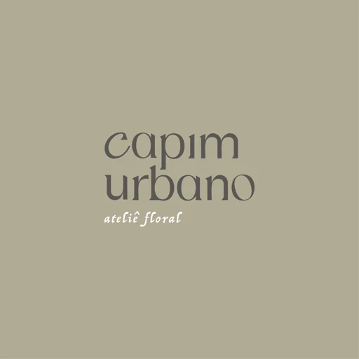
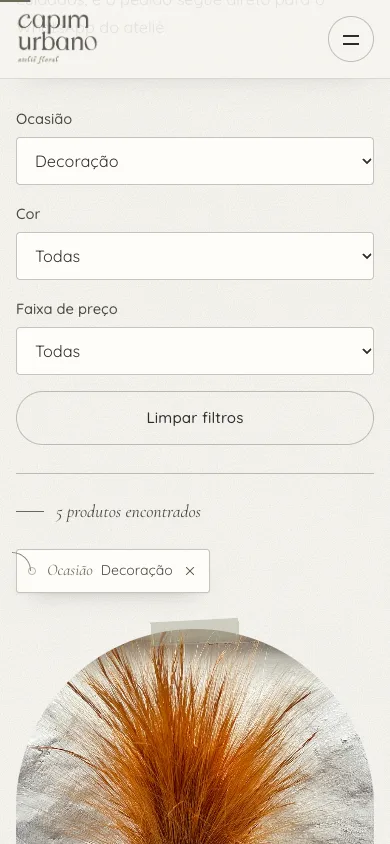
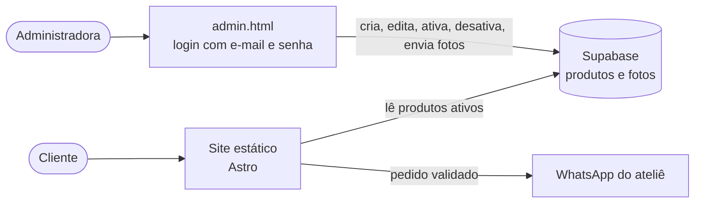
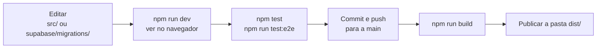

<p align="center">
  
</p>

<h1 align="center">Capim Urbano — Ateliê Floral</h1>

<p align="center">
  Site e catálogo digital de flores desidratadas, de Tubarão (SC).<br>
  O cliente escolhe, personaliza e conclui o pedido pelo WhatsApp. A administradora cuida dos produtos sozinha.
</p>

<p align="center">
  <sub>Feito por <a href="https://github.com/gstvdc"><strong>Gustavo Constante</strong></a> e <a href="https://github.com/LuqBruno"><strong>Bruno Luque</strong></a></sub>
</p>

<p align="center">
  
  &nbsp;
  
</p>

Planejamento, requisitos e andamento ficam no Trello:
[Capim Urbano — Kanban de Requisitos, Design e Desenvolvimento](https://trello.com/b/l6GKHhLH/capim-urbano-kanban-de-requisitos-design-e-desenvolvimento)

## Em resumo

| | |
|---|---|
| **O que é** | Site institucional + catálogo + pedido personalizado + administração de produtos |
| **Feito com** | [Astro](https://astro.build/) (site estático), JavaScript no navegador, [Tailwind CSS](https://tailwindcss.com/) 4 e [Supabase](https://supabase.com/) (banco, login e fotos) |
| **Quem usa** | Clientes (catálogo e pedido), a administradora (`admin.html`) e a equipe técnica |
| **Idiomas** | Português na raiz do site, inglês em `en/` e espanhol em `es/`, com seletor de idioma no cabeçalho. Os dados dos produtos vêm do banco em português |
| **Como publica** | A cada push na `main`, o GitHub Actions faz o build e publica a pasta `dist/` no GitHub Pages (veja [Publicação](#publicação)) |
| **Como os produtos mudam** | A administradora salva em `admin.html` e o catálogo mostra para todos, **sem refazer o build** |

## Como o site funciona



**Quem pode o quê** é decidido pelo banco (regras de segurança por linha, RLS), não pela tela:

| Quem | Vê produtos | Altera produtos e fotos |
|---|---|---|
| Visitante | só os ativos | não |
| Conta logada que não é administradora | só os ativos | não |
| Administradora | todos, inclusive desativados | sim |

## Quem faz o quê

| Eu sou… | Quero… | Vá para |
|---|---|---|
| **Cliente** | ver produtos, filtrar e pedir | [`catalogo.html`](#páginas) e o [manual](docs/manual.md#para-o-cliente) |
| **Administradora** | cadastrar, editar, desativar produtos e enviar fotos | [`admin.html`](#páginas) e o [manual](docs/manual.md#para-a-administradora-adminhtml) |
| **Equipe técnica** | rodar, testar, mudar o código ou o banco e publicar | [Primeiros passos](#primeiros-passos) e [Fluxo de trabalho](#fluxo-de-trabalho) |

## Primeiros passos

Requer **Node 22.23.4 ou superior** (exigência do Astro 7) e npm.

```bash
npm install          # uma vez
npm run dev          # servidor de desenvolvimento em http://localhost:4321
npm run build        # gera o site estático em dist/
npm run preview      # serve o dist/ para conferir o resultado final
```

A pasta `dist/` é o site pronto: qualquer hospedagem estática serve (Netlify, Vercel, GitHub Pages, Cloudflare Pages…).

## Fluxo de trabalho



1. **Código ou textos do site:** edite em `src/`, confira com `npm run dev` e rode os dois conjuntos de testes.
2. **Produtos, preços e fotos:** não precisam de código nem de build. Use `admin.html`.
3. **Banco de dados:** toda mudança vira um arquivo novo em `supabase/migrations/` e é aplicada no projeto. Não altere só pelo painel.
4. **Antes de entregar:** os dois conjuntos de testes passando e as páginas conferidas em 375px (celular) e 1280px (desktop), sem rolagem horizontal e sem erros no console.
5. **Publicar:** é automático. O push na `main` dispara o workflow, que roda os testes de regras, faz o build e publica. Um novo build só é necessário quando o código ou os textos do site mudam.

## Publicação

O site é publicado no **GitHub Pages** pelo workflow [`.github/workflows/deploy.yml`](.github/workflows/deploy.yml): a cada push na `main` ele instala as dependências, roda `npm test`, faz `npm run build` e publica a pasta `dist/`.

**Configuração única (no GitHub):** em *Settings → Pages → Build and deployment → Source*, escolha **GitHub Actions**. Neste repositório isso já está feito (04/11/2026): a verificação extra "pages build and deployment" não roda mais, e o único workflow de publicação é o `Publicar no GitHub Pages`. Se ficar em "Deploy from a branch", o GitHub tenta construir o repositório com **Jekyll** e o build falha, porque os arquivos `.astro` começam com `---` e o Jekyll os lê como YAML.

- O endereço padrão é `https://<usuário>.github.io/<repositório>/`. Por isso o workflow define `BASE_PATH=/<repositório>` e `SITE_URL`, e o `astro.config.mjs` usa esses valores. Localmente e nos testes eles ficam vazios e o site é servido na raiz.
- Com domínio próprio, defina `BASE_PATH` como `/` (ou remova a variável) e `SITE_URL` com o domínio.
- Depois de publicar, coloque o endereço do site em *Authentication → URL Configuration* do Supabase (*Site URL*), para o e-mail de recuperação de senha abrir a página certa.
- Qualquer outra hospedagem estática também serve: rode `npm run build` e publique a pasta `dist/`.

## Páginas

O corpo de cada página pública fica em `src/paginas/<Nome>.astro` e recebe a língua. `src/pages/<nome>.astro` publica a versão em português como `<nome>.html`, e `src/pages/[lingua]/[pagina].astro` publica as versões em inglês e espanhol como `en/<nome>.html` e `es/<nome>.html`. Os nomes dos arquivos são os mesmos nas três línguas, então o seletor de idioma leva à mesma página (e mantém `?id=` do produto). A administração e a página 404 existem só em português.

| Página | Endereço | Descrição |
|---|---|---|
| Início e serviços | `index`, `servicos`, `assinatura-floral`, `eternizacao-de-flores`, `oficinas-florais`, `arranjos-e-presentes`, `contato` | Site institucional. |
| Catálogo | `catalogo.html` | Lista de produtos com filtros combináveis por ocasião, cor e faixa de preço. Os filtros ficam na URL (`?ocasiao=…&cor=…&faixa=…`). |
| Produto | `produto.html?id=<id>` | Fotos, preço, disponibilidade, prazo, durabilidade e cuidados. |
| Pedido | `pedido.html` (`?produto=<id>` opcional) | Formulário com validação, resumo e envio pelo WhatsApp. |
| Administração | `admin.html` | Login (e-mail e senha) e cadastro de produtos com envio de fotos. Grava no Supabase e vale para todos os clientes. |

Mapeamento com o Trello: US01, US02, US04, **US06**, RN01 (regras), RN02, NFR01 e NFR02 estão atendidos (na NFR02 falta só a verificação manual com leitor de tela, outros navegadores e aparelhos reais). **US03 e US05 estão parciais**: a referência visual é um link e o pedido é de um produto por vez. Os detalhes estão na [matriz de requisitos](docs/matriz-de-requisitos.md).

## Regras de negócio

- Todo produto mostra nome, foto, categoria, descrição, preço (ou "Sob orçamento"), disponibilidade e prazo. Cuidados e durabilidade aparecem quando existirem, ou um aviso quando faltarem.
- Produto **indisponível** aparece no catálogo, mas **não pode ser pedido**. Produto **desativado** não aparece.
- O pedido exige nome, quantidade (1 a 99), ocasião e cores. Tamanho, orçamento, link de referência e observações são opcionais. O WhatsApp só abre depois do resumo e da confirmação do cliente. Disponibilidade e valor final são confirmados no atendimento.
- Se a busca dos produtos falhar, o catálogo mostra uma mensagem com "Tentar de novo". Os produtos padrão de `src/lib/catalogo-dados.js` **não** aparecem no lugar, para não mostrar preço ou disponibilidade desatualizados. Só quando `src/lib/supabase-config.js` não está configurado o site usa esse catálogo padrão.
- Número do WhatsApp: `5548991765295`, definido só em `src/lib/catalogo-core.js` (`WHATSAPP`). Todos os links `wa.me` do site são montados a partir dele.
- Cada produto tem: `id`, `nome`, `categoria`, `descricao`, `fotos[]`, `preco` (número, ou `null` para "sob orçamento"), `disponibilidade` (`disponivel`, `sob-encomenda` ou `indisponivel`), `prazo`, `durabilidade`, `cuidados`, `ocasioes[]`, `cores[]` e `ativo`. Detalhes no [modelo de dados](docs/modelo-de-dados.md).

## Estrutura do projeto

```
astro.config.mjs            configuração do Astro (saída estática, páginas como nome.html)
package.json                scripts e dependências (astro e @supabase/supabase-js)
src/pages/*.astro           uma página por arquivo; as públicas só chamam o componente de src/paginas/ em português
src/pages/[lingua]/[pagina].astro  gera as páginas públicas em en/ e es/
src/paginas/                corpo das páginas públicas (Inicio, Catalogo, Produto, Pedido, Servicos…), com a prop lingua
src/i18n/site.js            textos das páginas nas três línguas
src/i18n/interface.js       línguas, textos usados pelos scripts e pelo core (preço, erros, mensagem do WhatsApp)
src/i18n/rotas.js           prefixo dos arquivos fora da raiz, links entre línguas e links do WhatsApp
src/pages/404.astro         página de erro (404.html), fora dos buscadores
src/pages/robots.txt.js     gera robots.txt (esconde admin.html e aponta o sitemap)
src/pages/sitemap.xml.js    gera sitemap.xml das páginas públicas nas três línguas, com os endereços alternativos
src/layouts/Base.astro      <head>, cabeçalho, rodapé e scripts comuns a todas as páginas
src/components/             Header.astro (menu com página atual e seletor de idioma), Footer.astro, Icone.astro (ícones de traço), Varal.astro, Topo.astro (título e nota das páginas internas), Chamada.astro (chamada final), Passos.astro e Migalhas.astro
src/styles/global.css       Tailwind (tema com as cores, fontes e medidas da marca), base, componentes e o herbário
src/scripts/site.js         menu, animações e rolagem do site institucional
src/scripts/catalogo.js     interface do catálogo, produto e pedido
src/scripts/admin.js        interface da administração
src/scripts/varal.js        interação e animação do varal de fotos da home
src/lib/catalogo-core.js    regras de negócio, sem DOM (módulo ES testável em Node)
src/lib/varal-core.js       física do varal (cordão, mola e balanço), sem DOM e testada em Node
src/lib/catalogo-dados.js   produtos padrão (os mesmos do banco); reserva quando o Supabase não está configurado
src/lib/supabase-config.js  URL do projeto e chave publicável do Supabase (nunca a service_role)
.github/workflows/          deploy.yml (build e publicação no GitHub Pages) e verificar-catalogo.yml (confere o catálogo a cada 3 dias)
public/imagens/web/         imagens otimizadas (.webp) usadas pelo site (copiadas para dist/imagens/web/)
supabase/migrations/        SQL do banco (tabelas, RLS, Storage e carga inicial)
scripts/gerar-seed.js       gera o SQL de carga inicial a partir de catalogo-dados.js
tests/                      testes automatizados
docs/                       manual, modelo de dados, matriz de requisitos, plano do Supabase e relatório
```

## Testes

```bash
npm test             # regras de negócio (filtros, validação, WhatsApp, cadastro, conversão com o banco), física do varal e traduções
npm run test:e2e     # constrói o site e testa as telas: fluxo, responsividade (375/768/1280px), acessibilidade e as versões em inglês e espanhol
```

- Os testes de tela abrem o `dist/` e usam o pacote `playwright` (`npm i -g playwright`, com `NODE_PATH` apontando para a pasta global de módulos) e um Chromium. Sem o pacote, eles são ignorados. Use `CHROMIUM_PATH=/caminho/do/chromium` para apontar um navegador específico.
- Eles **não usam a rede**: o Supabase é simulado com `page.route` e o `supabase-js` já vai dentro do bundle do site.
- A checagem das regras de segurança do banco (RLS) é feita à parte, no próprio Supabase (veja o [plano](docs/supabase-plano.md)).

## Documentação

- [Manual](docs/manual.md): uso para cliente, administradora e equipe técnica (inclui a publicação).
- [Modelo de dados](docs/modelo-de-dados.md): produto, pedido, tabelas do banco e regras de segurança.
- [Matriz de requisitos](docs/matriz-de-requisitos.md): cards do Trello, código e testes.
- [Relatório de qualidade e desempenho](docs/relatorio-qualidade.md).
- [Integração com o Supabase](docs/supabase-plano.md): o que foi feito, o projeto, os desvios do plano e o que falta.
- [AGENTS.md](AGENTS.md): guia para quem mexe no código (pessoas e agentes de IA).

## Pendências conhecidas

1. **Produtos:** os 7 do banco foram aprovados como oficiais pelo Product Owner em 03/11/2026. Preço, prazo e disponibilidade mudam em `admin.html`, sem refazer o build.
2. **Conta de administradora:** o cadastro público de usuários está desligado (03/11/2026) e existe uma única conta com permissão de escrita. A senha atual é curta; troque por uma de 12 caracteres ou mais, em *Authentication → Users* do Supabase. A proteção contra senhas vazadas só existe no plano Pro. Detalhes em [docs/supabase-plano.md](docs/supabase-plano.md).
3. **Referência visual no pedido é um link**, não um upload. O cliente pode enviar a imagem direto na conversa do WhatsApp.
4. **Plano gratuito do Supabase** pausa o projeto depois de 7 dias sem uso, o que tira o catálogo do ar (já aconteceu em 01/11/2026). O workflow `verificar-catalogo.yml` consulta o catálogo a cada 3 dias, o que conta como uso e, se o projeto já estiver pausado, falha e o GitHub avisa por e-mail. Para eliminar a pausa de vez, avalie um plano pago antes de divulgar.
5. **Traduções:** os textos em inglês e espanhol foram escritos a partir do português e ainda precisam da revisão do Product Owner ou de alguém fluente. Nome, categoria, descrição, prazo, cuidados, ocasiões e cores dos produtos vêm do banco e aparecem em português nas três versões; traduzi-los exige colunas novas e campos novos na administração. As mensagens do WhatsApp enviadas pelas versões em inglês e espanhol chegam ao ateliê nessas línguas.
6. **Testes manuais que a automação não cobre:** leitor de tela real, Safari e Firefox, aparelhos físicos. A automação cobre contraste e regras WCAG 2.2 AA com o axe-core, em todas as páginas, em celular e desktop.

## Créditos

Feito por **Gustavo Constante** ([@gstvdc](https://github.com/gstvdc)) e **Bruno Luque** ([@LuqBruno](https://github.com/LuqBruno)), para a Capim Urbano Ateliê Floral.

## Identidade visual

O site segue o conceito **Herbário Capim Urbano**: como o ateliê preserva flores, o site se apresenta como um herbário vivo, o arquivo onde espécimes são prensados, numerados e etiquetados.

| Elemento do herbário | Onde aparece |
|---|---|
| Papel de arquivo | grão sutil no fundo de papel de todas as páginas |
| Janela em arco de estufa | foto principal da home (com um arco sálvia deslocado atrás, como papel recortado), fotos do catálogo e do produto, foto do ateliê (token `--arch`) |
| Espécime preso com fita | fita translúcida no topo de cada produto do catálogo |
| Ficha numerada | cartão do produto com "Nº 01, Nº 02…" (ordem do catálogo) e a "Ficha da peça" na página do produto |
| Varal de secagem | logo abaixo da abertura, sobre uma faixa sálvia: fotos do ateliê como polaroids presas num cordão que cede, na home (`src/components/Varal.astro`): arraste, clique, use ←/→ ou os botões; balançam conforme a velocidade e há botão de pausar o autoplay |
| Etiquetas amarradas | filtros aplicados no catálogo viram etiquetas de arquivo (ilhós e linha), removíveis uma a uma |
| Mural de recortes | fotos do Instagram na home coladas com fita e levemente tortas; passar o mouse "alisa" o recorte |
| Carimbo da coleção | selo "Herbário Capim Urbano · Tubarão · SC" no canto do rodapé, que gira só com a rolagem (parado com menos movimento) |
| Esqueleto em arcos | enquanto o catálogo carrega, três espécimes em silhueta, presos com fita |
| Etiqueta do pedido | o resumo do pedido é uma ficha presa com fita, com o título na borda, e entra com uma leve inclinação |
| Espécime não catalogado | a página 404 traz uma ficha "Nº 404" com o raminho |
| Folhear o arquivo | o movimento do site: a página vira como uma folha ao navegar (transições de visualização, com o cabeçalho parado), a foto do produto é desvendada pelo arco e a ficha chega em ordem, as fichas do catálogo pousam em sequência quando os filtros mudam, a foto "vira" ao trocar a miniatura e as fotos grandes respiram levemente com a rolagem. Tudo em CSS e tudo para com `prefers-reduced-motion` |

Os elementos decorativos têm `aria-hidden` e o movimento para quando a pessoa pede menos animação no sistema (`prefers-reduced-motion`). O CSS do conceito fica no fim de `src/styles/global.css`, depois dos componentes, para vencer as regras anteriores.


- **Marca:** a logo oficial (letras grafite e "ateliê floral" manuscrito) está em `public/imagens/marca/`: `logo-sobre-papel.webp` (manuscrito em sálvia, usada no cabeçalho) e `logo-sobre-salvia.webp` (manuscrito branco, usada no rodapé, que reproduz o cartão da marca).
- **Paleta da marca** (medida na logo): sálvia `#b1aa97`, grafite `#5b5852` e branco, sobre papel claro `#f6f4ef`. O destaque de textos e links é o sálvia-grafite `#6e6a5a` (`--acento`). Texto sobre sálvia usa `#3d3b36` (`--sobre-salvia`) para manter o contraste AA. O vinho fica só para erro e "indisponível".
- **Tipografia:** **Quicksand** no texto, **Cormorant Garamond** em peso leve nos títulos e **Allura** no manuscrito "plantar beleza, colher alegria", como nos posts da marca.
- Os tokens ficam no `@theme` de `src/styles/global.css` e viram classes do Tailwind (`bg-paper`, `text-acento`, `font-serif`, `rounded-arch`…). A paleta padrão do Tailwind está desligada: só existem as cores da marca.
- Meta de acessibilidade: foco visível, rótulos em todos os campos, mensagens de erro com `role="alert"` e navegação por teclado.
